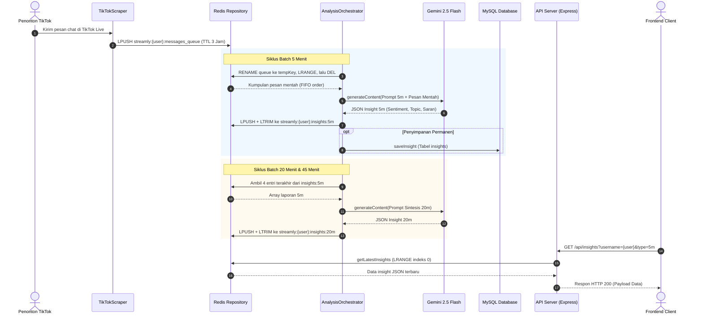

# Arsitektur Database dan Penyimpanan Backend Streamly

Dokumen ini memaparkan rancangan arsitektur backend Streamly dengan fokus utama pada layer penyimpanan data (*database layer*). Penjelasan mencakup pemilihan teknologi, skema basis data, struktur key, manajemen konkurensi, hingga alasan teknis perubahan sistem dari basis vektor ke model agregasi berjenjang.

---

## 1. Gambaran Umum Layer Penyimpanan

Sistem backend Streamly berhadapan langsung dengan arus komentar siaran langsung TikTok (*live stream*) yang datang dalam volume besar serta interval tak tentu. Untuk menyeimbangkan kebutuhan kecepatan ingest data mentah dan analisis berkala, arsitektur backend membagi beban penyimpanan ke dalam dua jenis sistem:

1. **Redis (In-Memory Key-Value & Message Broker):** Menangani *queue* pesan masuk dan menyimpan ringkasan hasil analisis (*insight buffer*) agar siap disajikan ke API secara instan.
2. **MySQL (Relational Database):** Berperan sebagai penyimpanan permanen untuk pengarsipan pesan teks dan catatan riwayat analisis jangka panjang.

```
+------------------------+
|      TikTok Live       |
+------------------------+
            | (WebSocket Chat Event)
            v
+------------------------+
|     TikTokScraper      |
+------------------------+
            |
            | LPUSH raw chat
            v
+-------------------------------------------------------+
|                 REDIS IN-MEMORY STORE                 |
|  1. Queue: streamly:{user}:messages_queue             |
|  2. Buffer: streamly:{user}:insights:{5m|20m|45m}     |
+-------------------------------------------------------+
       ^                         |
       | LPUSH+LTRIM insight     | RENAME + LRANGE + DEL
       |                         v
+-------------------------------------------------------+
|                 AnalysisOrchestrator                  |
|          (Jadwal: 5 menit, 20 menit, 45 menit)        |
+-------------------------------------------------------+
            |                          |
            | Request inference        | Simpan arsip (opsional)
            v                          v
+------------------------+   +--------------------------+
|  Gemini 2.5 Flash API  |   |          MySQL           |
| (Structured JSON Mode) |   | (messages & insights tbl)|
+------------------------+   +--------------------------+
            |
            | Response JSON
            v
+-------------------------------------------------------+
|                   API Server (Express)                |
|           Endpoint: GET /api/insights?username=       |
+-------------------------------------------------------+
            ^
            | Polling HTTP (15s)
+------------------------+
|   Frontend (React)     |
+------------------------+
```

---

## 2. Implementasi Redis

Komponen Redis diimplementasikan pada berkas `src/internal/repository/redis.ts` menggunakan *library* `ioredis`. Redis memegang dua tugas operasional utama:

### A. Antrean Pesan (*Message Queue*)
Saat *scraper* mendeteksi komentar baru dari siaran langsung, pesan langsung dimasukkan ke dalam antrean Redis khusus untuk kreator yang bersangkutan.

- **Pola Key:** `streamly:{username}:messages_queue`
- **Operasi Ingest:** `LPUSH streamly:{username}:messages_queue payload`
- **TTL (Time to Live):** 3 jam (10.800 detik). Pemberian kedaluwarsa otomatis ini mencegah penumpukan data di memori jika proses *consumer* mati sementara *scraper* terus berjalan.
- **Mekanisme Pengambilan Atomik:**
  Untuk mencegah benturan (*race condition*) antar siklus baca-tulis, orchestrator tidak memakai kombinasi sederhana `LRANGE` lalu `DEL`. Sistem memakai perintah `RENAME`:
  1. *Key* antrean utama diubah namanya secara atomik menjadi *key* sementara: `streamly:{username}:messages_queue:{timestamp}`.
  2. Data dibaca dari *key* sementara memakai `LRANGE 0 -1`.
  3. *Key* sementara segera dihapus lewat `DEL`.
  4. Karena pesan masuk secara *Last-In First-Out* (LIFO) melalui `LPUSH`, urutan dibalik (`reverse()`) pada sisi aplikasi agar orchestrator menerima pesan berurutan kronologis (*First-In First-Out* / FIFO).

### B. Penyimpanan Riwayat Insight (*Bounded Ring Buffer*)
Hasil analisis dari model AI disimpan kembali ke Redis agar endpoint HTTP dapat membacanya tanpa menyentuh disk fisik.

- **Pola Key:** `streamly:{username}:insights:{batchType}`
  - Nilai `batchType`: `5m`, `20m`, atau `45m`.
- **Operasi Pipeline Atomik:**
  Penyimpanan data baru dijalankan bersamaan dengan pemotongan batas antrean menggunakan Redis pipeline:
  ```typescript
  const pipeline = this.client.pipeline();
  pipeline.lpush(key, payload);
  pipeline.ltrim(key, 0, maxLength - 1);
  await pipeline.exec();
  ```
- **Batasan Panjang Riwayat (*Buffer Size*):**
  Ukuran daftar dipertahankan tetap sesuai jendela analisis agar memori server terkendali:

| Tipe Batch | Batas Maksimum Entri (`maxLength`) | Estimasi Rentang Riwayat Aktif |
| :--- | :--- | :--- |
| `5m` | 10 laporan | ~50 menit aktivitas siaran |
| `20m` | 5 laporan | ~100 menit aktivitas siaran |
| `45m` | 3 laporan | ~135 menit aktivitas siaran |

Data riwayat 5 menit ini dipakai langsung oleh orchestrator sebagai bahan masukan saat mensintesis laporan 20 menit. Begitu pula laporan 20 menit dan 5 menit yang diolah kembali menjadi laporan 45 menit.

---

## 3. Implementasi MySQL

Persistensi relasional diimplementasikan pada berkas `src/internal/repository/db.ts` dan didefinisikan lewat `src/internal/repository/schema.sql` menggunakan driver `mysql2/promise`.

### A. Konfigurasi Koneksi
Database menggunakan *connection pool* dengan parameter:
```typescript
this.pool = mysql.createPool({
    host: config.db.host,
    port: config.db.port,
    user: config.db.user,
    password: config.db.password,
    database: config.db.database,
    waitForConnections: true,
    connectionLimit: 10,
    queueLimit: 0,
    multipleStatements: true
});
```

### B. Skema Relasional (5 Tabel Terintegrasi)

Sesuai rancangan pada `tubes/Streamly/skets/streamly_db_design/schema.sql`, skema relasional terdiri dari 5 tabel terstruktur:

#### 1. Tabel `live_sessions`
Mencatat setiap sesi siaran langsung yang dipantau oleh scraper.
```sql
CREATE TABLE IF NOT EXISTS live_sessions (
  id BIGINT UNSIGNED NOT NULL AUTO_INCREMENT,
  username VARCHAR(100) NOT NULL,
  room_id VARCHAR(100) NULL,
  status ENUM('starting','active','ended','failed') NOT NULL DEFAULT 'starting',
  started_at DATETIME(3) NOT NULL DEFAULT CURRENT_TIMESTAMP(3),
  ended_at DATETIME(3) NULL,
  created_at TIMESTAMP NOT NULL DEFAULT CURRENT_TIMESTAMP,
  updated_at TIMESTAMP NOT NULL DEFAULT CURRENT_TIMESTAMP ON UPDATE CURRENT_TIMESTAMP,
  PRIMARY KEY (id),
  KEY idx_sessions_username_started (username, started_at),
  KEY idx_sessions_status (status),
  CONSTRAINT chk_session_times CHECK (ended_at IS NULL OR ended_at >= started_at)
) ENGINE=InnoDB;
```

#### 2. Tabel `messages`
Menyimpan riwayat komentar chat mentah dari penonton per sesi streaming.
```sql
CREATE TABLE IF NOT EXISTS messages (
  id BIGINT UNSIGNED NOT NULL AUTO_INCREMENT,
  session_id BIGINT UNSIGNED NOT NULL,
  message_time DATETIME(3) NOT NULL,
  tiktok_user_id VARCHAR(100) NULL,
  display_name VARCHAR(100) NULL,
  message TEXT NOT NULL,
  created_at TIMESTAMP NOT NULL DEFAULT CURRENT_TIMESTAMP,
  PRIMARY KEY (id),
  KEY idx_messages_session_time (session_id, message_time),
  CONSTRAINT fk_messages_session FOREIGN KEY (session_id)
    REFERENCES live_sessions(id) ON DELETE CASCADE
) ENGINE=InnoDB;
```

#### 3. Tabel `insights`
Menyimpan laporan hasil inferensi AI Gemini dalam tiga rentang jendela waktu (`5m`, `20m`, `45m`).
```sql
CREATE TABLE IF NOT EXISTS insights (
  id BIGINT UNSIGNED NOT NULL AUTO_INCREMENT,
  session_id BIGINT UNSIGNED NOT NULL,
  batch_type ENUM('5m','20m','45m') NOT NULL,
  sentiment_score DECIMAL(5,4) NULL,
  sentiment_trend ENUM('rising','falling','stable') NULL,
  emerging_topics JSON NULL,
  summary TEXT NOT NULL,
  actionable_insight TEXT NOT NULL,
  message_count INT UNSIGNED NOT NULL DEFAULT 0,
  model_name VARCHAR(100) NULL,
  generated_at DATETIME(3) NOT NULL,
  created_at TIMESTAMP NOT NULL DEFAULT CURRENT_TIMESTAMP,
  PRIMARY KEY (id),
  KEY idx_insights_session_type_time (session_id, batch_type, generated_at),
  CONSTRAINT fk_insights_session FOREIGN KEY (session_id)
    REFERENCES live_sessions(id) ON DELETE CASCADE,
  CONSTRAINT chk_sentiment_score CHECK (sentiment_score IS NULL OR (sentiment_score >= -1 AND sentiment_score <= 1))
) ENGINE=InnoDB;
```

#### 4. Tabel `insight_messages`
Menghubungkan komentar obrolan mana saja yang dianalisis dalam laporan 5 menit (*provenance tracking*).
```sql
CREATE TABLE IF NOT EXISTS insight_messages (
  insight_id BIGINT UNSIGNED NOT NULL,
  message_id BIGINT UNSIGNED NOT NULL,
  PRIMARY KEY (insight_id, message_id),
  KEY idx_insight_messages_message (message_id),
  CONSTRAINT fk_im_insight FOREIGN KEY (insight_id)
    REFERENCES insights(id) ON DELETE CASCADE,
  CONSTRAINT fk_im_message FOREIGN KEY (message_id)
    REFERENCES messages(id) ON DELETE CASCADE
) ENGINE=InnoDB;
```

#### 5. Tabel `insight_dependencies`
Menghubungkan laporan 20m dan 45m dengan input laporan 5m/20m sebelumnya (*hierarchical synthesis tracking*).
```sql
CREATE TABLE IF NOT EXISTS insight_dependencies (
  insight_id BIGINT UNSIGNED NOT NULL,
  source_insight_id BIGINT UNSIGNED NOT NULL,
  PRIMARY KEY (insight_id, source_insight_id),
  KEY idx_insight_dependencies_source (source_insight_id),
  CONSTRAINT fk_id_insight FOREIGN KEY (insight_id)
    REFERENCES insights(id) ON DELETE CASCADE,
  CONSTRAINT fk_id_source_insight FOREIGN KEY (source_insight_id)
    REFERENCES insights(id) ON DELETE CASCADE,
  CONSTRAINT chk_insight_not_self CHECK (insight_id <> source_insight_id)
) ENGINE=InnoDB;
```

---

## 4. Evolusi Basis Data: Transisi dari Qdrant ke Redis Hierarkis

Pada iterasi awal (Streamly v2), sistem sempat mengadopsi basis data vektor **Qdrant** (`@qdrant/js-client-rest`). Rencana awal v2 adalah mengubah setiap batch pesan obrolan menjadi representasi vektor (*embedding* teks via Google AI) dan mencari kesamaan semantik (*cosine similarity*) terhadap memori masa lalu.

Namun pada implementasi v3 (*Hierarchical Summarization*), Qdrant diputuskan dilepas sepenuhnya dengan alasan teknis berikut:

1. **Efisiensi Latensi Operasional:** Obrolan siaran langsung bergerak sangat cepat. Menjalankan proses embedding per kelompok pesan sebelum menghasilkan ringkasan memakan waktu tunggu tambahan dan kuota API yang tidak sebanding dengan hasilnya.
2. **Karakter Alami Data Berbasis Waktu:** Evaluasi tren obrolan penonton lebih akurat jika dianalisis berdasarkan urutan kronologis bertingkat, bukan berdasarkan pencarian kedekatan semantik acak antar vektor. 
3. **Penyederhanaan Infrastruktur:** Agregasi bertingkat (4 laporan `5m` dilebur jadi 1 laporan `20m`, lalu 2 laporan `20m` ditambah 1 laporan `5m` dilebur jadi laporan `45m`) cukup membutuhkan penyimpanan data terstruktur berurut di Redis. Langkah ini memangkas satu dependensi infrastruktur tanpa mengurangi ketajaman analisis tren.

---

## 5. Alur Data Antar Komponen

Rangkaian interaksi database selama siklus hidup sistem berlangsung sebagai berikut:



1. **Tahap Ingest:** Setiap event obrolan yang ditangkap `TikTokScraper` langsung di-push ke Redis List antrean pengguna target.
2. **Tahap Konsumsi Terjadwal:** Timer interval di dalam `AnalysisOrchestrator` memicu eksekusi batch 5m, 20m, atau 45m.
3. **Tahap Sintesis:** Data diambil dari Redis, diformat ke dalam prompt terstruktur, lalu diproses oleh `gemini-2.5-flash` dalam mode JSON.
4. **Tahap Caching Riwayat:** Objek hasil inferensi disimpan ke Redis List histori insight dengan pembatasan panjang (`LTRIM`).
5. **Tahap Penyajian:** Saat pengguna melihat dashboard di antarmuka web, polling berulang mengarah ke endpoint `GET /api/insights` yang langsung membaca memori Redis tanpa perlu membebani tabel relasional MySQL.
